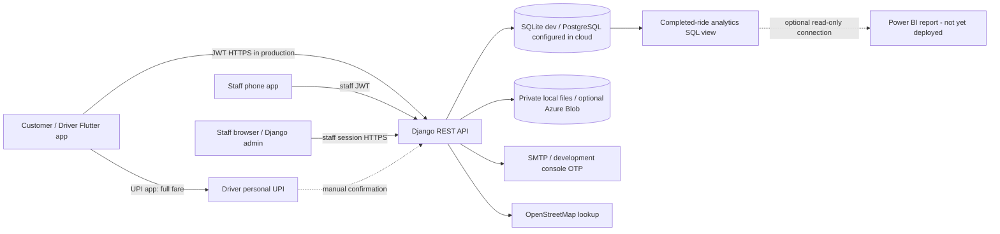
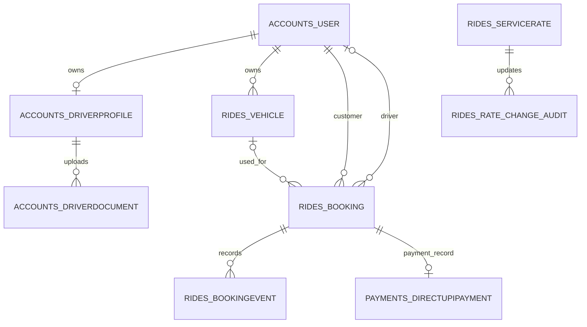

# DriveMate — project design, database & security submission

Status based on the repository and changes in this package. **Do not present the unchecked items as deployed or verified.**

## 1. Features and how to use them

### Driver documents
- Django admin (`/admin/`) → **Accounts → Driver documents (grouped)**: one row per driver. Open the row to see all uploaded document types together. Each document has a secure download, individual review status (Pending / Approved / Rejected), reason, reviewer and review time. Enter at least five characters when rejecting. Save once after editing. The separate individual-document list was replaced by this grouped view. Staff need the relevant model permissions.
- Flutter admin → Verification queue → select driver → Documents → each document's menu offers approve/reject/pending. Rejection requires a reason. The phone screen shows metadata/status, **not a document viewer**; use the secure download in Django admin to inspect the actual files.
- An application-level decision remains separate from document decisions. Existing driver approval checks whether required documents were uploaded, not whether each one is approved. Staff must manually check all document statuses before approving the driver. Changing a document's review status does not automatically suspend an already-approved driver.

### Ride rates and fee
- Django admin → **Rides → Ride rates** → edit base fare and hourly fare, in whole rupees, per service. On existing deployments run `python manage.py migrate` first; migration seeds current values. No customer can submit a price. Limits: base ≤ ₹10,00,000, hourly ≤ ₹1,00,000, both nonnegative.
- Fare = base + hourly rate × max(requested hours, service minimum); rounded to the nearest rupee. Service minimums remain fixed in `backend/rides/pricing.py` (Book now 1, Hourly 2, Full day 8, Airport 2, Outstation 6, Night 2). A valid promotion may reduce the booking estimate. Existing bookings keep the estimate saved at creation; new bookings use current rates. Completion uses that saved estimate. Rates are **not** editable from the phone admin screen.
- Fee = 18% of final fare, rounded to paise; driver share = fare minus fee. Example: ₹450 → fee ₹81, driver ₹369. `rides/pricing.py`, `Booking.payout`, and the analytics view calculate shares; they are **not evidence of actual transfers**.
- **Payment limitation:** current personal UPI QR sends the **full fare to the driver's own UPI**, subject to manual driver confirmation; cash is collected manually. Neither automatically transfers 18% to the platform nor 82% to the driver. No gateway settlement, webhook verification, refunds or payout reconciliation is implemented. Do not claim the commission has been collected. Real automated split needs an approved provider, merchant and driver onboarding/KYC, a settlement agreement, authenticated idempotent webhooks, reconciliation, refunds/disputes and end-to-end sandbox testing. See `docs/DIRECT_UPI_PAYMENT.md`.

## 2. System design

### Functional requirements
Registration and OTP login; customer and driver profiles; private driver-document upload and review; driver application review; customer vehicle management; service-based fare estimates and booking; driver availability, acceptance, start PIN and completion; notifications; manual cash or personal UPI reporting; administrative rate management and basic completed-ride analytics.

### Non-functional requirements
Confidentiality of identity documents and credentials; server-side authorization and input validation; accurate Decimal currency arithmetic; atomic ride transitions; searchable/indexed booking and document fields; backups and auditability; HTTPS for production; mobile usability. Capacity/SLA, disaster recovery, accessibility and production load testing are not yet verified.

### Architecture and data flow

Booking: app supplies service, duration and coordinates → server reads rate → calculates/stores estimate → driver accepts/starts/completes → final fare copied from stored estimate → fee/share displayed as calculated values. No automatic transfer to platform is shown in this flow.

### API list
Full routes are defined in `backend/accounts/urls.py`, `backend/rides/urls.py`, `backend/hub/urls.py`, `backend/payments/urls.py`; `docs/API.md` documents additional details. Key routes:
| Route | Purpose |
|---|---|
| `/api/health/` | Service health |
| `/api/auth/register/`, `verify-otp/`, `login/`, `token/refresh/` | Account and sessions |
| `/api/auth/driver/application/`, `driver/documents/` | Application and upload |
| `/api/auth/admin/drivers/`, `admin/drivers/<user_id>/application/`, `admin/drivers/<user_id>/review/` | Staff queue, detail, driver decision |
| `/api/auth/admin/documents/<document_id>/download/`, `review/` | Staff-only file and individual decision (`approve`, `reject`, `pending`; rejection requires reason) |
| `/api/rides/pricing/`, `vehicles/`, `bookings/` | Quote, vehicles, bookings |
| `/api/rides/requests/<id>/accept/`, `trips/<id>/start/`, `trips/<id>/complete/` | Ride lifecycle |
| `/api/rides/bookings/<id>/start-code/`, `cash/`, `receipt/` | PIN, manual cash, receipt |
| `/api/payments/driver/profile/`, `/api/payments/trips/<id>/`, `/report/`, `/review/` | Driver UPI setup, manual payment reporting/review |
| `/api/hub/tickets/`, `/api/hub/map/search/` | Support, map search |

### Written trade-off
A Django monolith shares a database transaction and validation rules between APIs and admin, reducing complexity for an early-stage product. It also couples deployments and scaling; isolate workloads only after monitoring shows a specific bottleneck. Introducing services now would require reliable message delivery, distributed tracing and more operational work.

## 3. RDBMS and ER diagram

SQLite is the development default; PostgreSQL is configurable. The canonical schema/changes are Django migrations. `schema_sqlite.sql` is an export **for a new empty SQLite database only**, not a migration for an existing installation. `queries.sql` contains a join, analytics view query, trigger audit query and a rolled-back transaction demo. For a live project use `python manage.py migrate`, not the exported schema. The migration `rides/0005_analytics_rate_audit.py` creates `rides_completed_analytics` and a rate-change audit trigger for SQLite/PostgreSQL. The trigger stores old/new rates and time; Django admin's own change log identifies the admin user for admin-originated edits. API document reviews store the latest reviewer/time but do not keep a full immutable history.


Primary keys and foreign keys are declared in model migrations. Examples of constraints: unique driver/document type, unique service rate, one active booking per customer and driver, unique payment reference, nonnegative/maximum rates. Booking status/customer/driver indexes and document type/status index are in models. `rides/views.py` uses `transaction.atomic` and `select_for_update` for booking workflows; SQLite locking differs from PostgreSQL, so production concurrency needs PostgreSQL testing.

The core entities above separate users, driver profiles, documents, vehicles, bookings and events. Some snapshots/JSON and denormalised fields are deliberately present for historical records and app needs; **a complete formal third-normal-form proof of every table has not been completed**. Review functional dependencies and remove unjustified redundancy before claiming full 3NF.

## 4. DP-900 / Azure evidence

| Data type | Examples | Current / target |
|---|---|---|
| Structured | users, profiles, bookings, rates | SQLite locally; configurable PostgreSQL; Azure PostgreSQL **not provisioned/verified** |
| Semi-structured | booking vehicle snapshot JSON, payment QR payload | database JSON/text; optional non-relational cloud store |
| Unstructured | identity images, PDFs, QR images | private local files; optional private Azure Blob configured in settings, **not provisioned/verified** |
| Analytics | completed rides, calculated commission and driver share | SQL view added; Power BI report **not created/verified** |

Cloud setup requires your own Azure subscription, costs, network and permissions:
1. Provision Azure Database for PostgreSQL Flexible Server; enable TLS, backups, least-privilege DB user and restrict firewall/private access. Install `requirements.txt` and `requirements-cloud.txt`; set `DB_ENGINE=django.db.backends.postgresql`, DB name/user/password/host/port and `DB_SSLMODE=verify-full`. Configure a trusted CA certificate as needed. Run migrations and test restores. PostgreSQL migration/trigger has not been tested here against a live Azure instance.
2. Create an Azure Storage account and a **private** blob container; block anonymous public access and restrict networking. Set `USE_AZURE_BLOB=true`, `AZURE_CONNECTION_STRING`, `AZURE_CONTAINER` via secret management, never in git. Existing local uploads do not move automatically; perform a verified migration of keys/objects and backups before switching storage. Test authorized and unauthorized downloads. Managed identity is preferable to a long-lived connection string in production but is not configured here.
3. Connect Power BI with a restricted read-only account to `rides_completed_analytics`; group by service/date and chart completed count, fare, calculated fee and calculated driver share. Configure gateway/network access and refresh as needed. Figures are **calculated, not settled**.
4. Take real screenshots of the Azure PostgreSQL resource, firewall/network settings, private Blob container and resulting Power BI report, then include them in the submission. None are included or fabricated in this package.

## 5. Cloud security and threat model

See `SECURITY.md` for the one-page threat model and honest checklist. Production HTTPS redirect and secure cookies now activate with `DEBUG=false`. When using TLS termination set `TRUST_PROXY_HTTPS=true` only if a trusted proxy overwrites the forwarded-proto header. Configure HTTPS at the proxy and trusted host/CORS/CSRF origins. No actual Azure network rule or TLS certificate was provisioned here.

## 6. Run, test and GitHub

Back up database and private files first. In backend, install requirements, run migrations and launch as described in the top-level README and `docs/RUN_AND_TEST.md`:
```bash
python manage.py migrate
python manage.py createsuperuser  # only if you do not have a staff/superuser login
python manage.py test accounts rides payments hub
python manage.py runserver
```
Rebuild the Flutter app for the document-review UI. A Flutter SDK was not available in this environment, so Flutter build/analyze was not run. Database migrations and backend tests were run with local SQLite; no Azure, PostgreSQL server, payment provider or bank was connected. The repository contains a tracked `backend/db.sqlite3.bak`; inspect it and remove it from version control if it may contain real/private data, including prior Git history where appropriate. Do not commit `.env`, credentials or private uploads.

Hindi subject-wise status aur Windows commands: [PROJECT_STATUS_HINDI.md](PROJECT_STATUS_HINDI.md).
